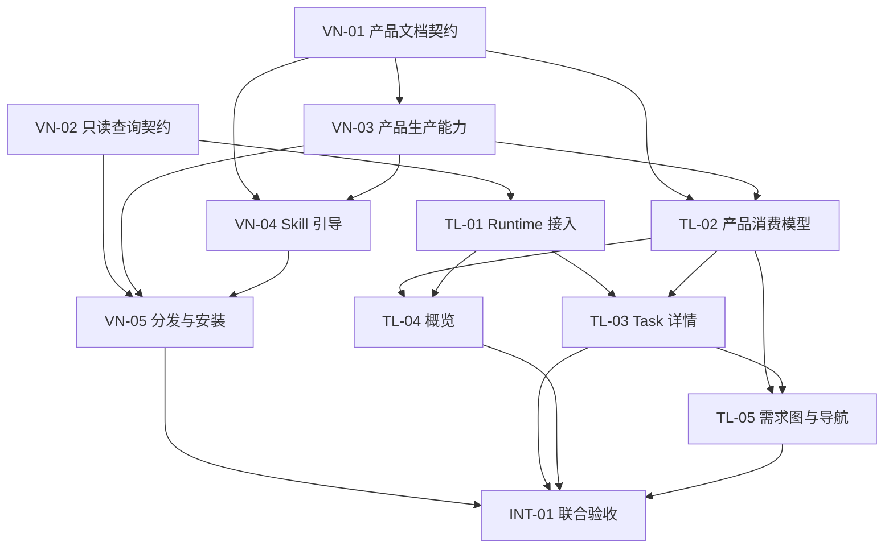

# TraceLens 与 vNext 实施任务拆分与验收计划

状态：VN-01、VN-02 契约交接完成；VN-03 源码与本地产物实现及聚焦验证完成，混合格式需求顺序登记审查意见已闭环。VN-04、VN-05、TraceLens 和 INT-01 未开始。整理及更新日期：2026-10-11。

契约阶段结果见[VN-01／VN-02 验收记录](./vnext-contracts-vn01-vn02-validation.md)，当前实现结果见[VN-03 交付记录](./vnext-vn03-product-validation.md)。产品字段、版本、选择规则以[文档契约第 10 节](../product/project-maintenance/document-contract.md#10-vn-01-最小增量目标需求顺序与范围化报告)为准，当前只读查询以[ASSISTANCE_API 消费契约](../../runtime/vnext/support/ASSISTANCE_API.md#read-only-consumer-contract-vn-02)为准。v3 已由 VN-03 在源码及本地产物支持，尚未验证完整分发安装或真实 TraceLens 消费。

依据：[目标需求管理及可视化完整方案](./TraceLens与vNext_目标需求管理及可视化完整方案.md)。产品口径以该定稿为准，本计划将其拆为 vNext 五个工作包、TraceLens 五个工作包和一个联合验收工作包，明确交接、依赖与完成标准。

推荐先并行明确产品文档表达和现有 Runtime 查询契约，再分别推进生产侧、查询接入与产品读取，随后接入页面，最后验证分发产物与完整交互。Runtime 查询已有实现基础，不必等待全部产品维护改造才开始接入。

本文的 VN、TL、INT 编号只是规划引用，不是真实 `task_id`，也不要求一个工作包对应一个 Runtime Task。此前契约阶段未创建或切换 Task；本轮在提交契约资料后按用户授权实施 VN-03，建立独立任务并记录实际工作，保留原任务与旧展示缺口。只生成本地产品 helper 和交接资产，不修改 Skill、不构建完整分发包、不升级业务项目。

## 一 交付边界与职责

| 责任侧 | 负责的结果 | 不承担的职责 |
| --- | --- | --- |
| vNext | 定义并生产目标、需求顺序、范围化结论；维护 Skill 引导；提供当前只读任务契约与可安装产物 | 不替 TraceLens 做页面状态管理；不在 Runtime 内执行模型评估 |
| TraceLens | 读取产品文件；接入只读 Runtime；隔离项目、缓存与降级；呈现概览、需求图和任务详情 | 不写回产品或任务；不重放日志实现第二套 reducer；不自行评估需求是否满足 |
| 双方联合 | 用同一组样例核对生产、读取、页面及交互；区分源码通过和安装后可用 | 不做全面历史迁移，不要求 LawAgent、TermLink 先完成资料重整 |

各工作包由对应仓库的实施者承担；跨仓库契约由 vNext 维护、TraceLens 核对可消费性。无需新增审批角色或 Runtime 准入操作。具体人员、工期与真实 Task 在实际实施时按当前授权和工作量安排。

验收中的失败应阻止将相应功能宣称为已交付，但不得成为用户业务 Task 的 prepare、confirm、执行或 close 门槛。

### 后续审查与验收原则

所有工作包遵循[定稿方案 7.1.1 节](./TraceLens与vNext_目标需求管理及可视化完整方案.md#711-后续契约与-ai-指导审查原则2026-10-11-补充)：先区分格式／确定性机器规则、AI 行为指导、产品取舍与假设风险。每项意见说明执行主体、依据、触发条件及实际影响，按影响定级；不把文字更精确当成 AI 必然正确的保证，不把已明确的保守策略或想象边界直接列为必修缺陷。

VN-01／VN-02 只交接最小机器交换与消费约定，AI 业务判断仍由宿主承担；本轮用共用样例演算，不能据此宣称真实 Agent 或消费者通过。VN-04 的有限 Agent 交互用于观察必要行为，不能承诺全部场景必然正确。修订优先消除核心误导和可定位的消费歧义，不因审查自动扩大工作包、增设字段／状态机或 Task 门槛。

修订 0.3.2 对本轮追加三项意见重新定性：不完整报告并存与异常旧报告修正只补必要的消费规则和共用变体，不保留原高优先级缺陷定级；撤回“同目标无关范围使摘要待核对”为缺陷的判断，保留首版保守策略及其代价。VN-02 现有消费规则无需因此改动。

## 二 工作包总览

表中的前置依赖指可靠实现及正式验收所需的输入。等待交接时可以制作界面骨架或使用明确标注的夹具，但夹具通过不等于真实生产和消费已经贯通。

| 编号 | 归属与工作包 | 前置依赖 | 可交付结果 |
| --- | --- | --- | --- |
| VN-01 | vNext 产品文档最小契约 | 定稿方案 | 目标层次、项目顺序、当前分解、范围化结论的表达与样例 |
| VN-02 | vNext 当前只读查询契约 | 定稿方案 | 现有查询字段、上下文、版本、失败与安装入口约定及样例 |
| VN-03 | vNext 产品生产与维护能力 | VN-01 | Schema、解析、保存及维护分析支持新表达 |
| VN-04 | vNext Skill 引导与关闭后评估 | VN-01；集成验收依赖 VN-03 | 简短主 Skill 与现有 references 的完整行为指引 |
| VN-05 | vNext 生成分发与隔离安装验证 | VN-02、VN-03、VN-04 | 相互匹配的源码、生成物、Schema 和安装后可用证据 |
| TL-01 | TraceLens Runtime 读取与项目隔离 | VN-02 | 异步查询、缓存、版本一致性与文件降级 |
| TL-02 | TraceLens 产品文档消费与视图模型 | VN-01；正式资产交接依赖 VN-03 | 新文档可读，目标、顺序、范围结论可被页面准确使用 |
| TL-03 | TraceLens Task 详情与关联来源 | TL-01；产品关联集成依赖 TL-02 | 结构化 Task／Step 下钻、身份与来源分离 |
| TL-04 | TraceLens 项目概览 | TL-02；任务分布集成依赖 TL-01 | 总目标与单一需求区域，稳定项目顺序 |
| TL-05 | TraceLens 需求图与导航 | TL-02；任务下钻及返回验收依赖 TL-03 | 当前目标需求图、范围结论、详情和历史导航 |
| INT-01 | 联合验收与交付说明 | VN-05、TL-01 至 TL-05 | 合成资料端到端结果、安装结果、已知限制及交付清单 |

VN-01 与 VN-02 可以并行；TL-01 与产品生产线可以并行。TL-04、TL-05 可以先用 TL-02 的模型样例制作页面，最后接入 TL-01、TL-03 的真实查询结果。并行实施如涉及同一文件，应由明确的文件负责人集成，不能互相覆盖。

2026-10-11 工作包结果：VN-01 已确定最小字段、product-doc/v3 与旧格式边界，并提供共用演算；VN-02 已确定现有 task-query/v1、来源 read、可信固定入口、版本与降级规则。按新审查原则最终核对，未发现需要修订、会影响实际执行或机器消费的必要问题；10 个样例摘要、字段／快照及链接检查通过，现有查询定向测试重新运行 6 项通过、0 失败。确认两项契约交接完成，详细证据见[验收记录 4.2 节](./vnext-contracts-vn01-vn02-validation.md#42-按新审查原则的最终核对与交接确认)。完成范围不包含真实 Agent 行为、TraceLens 消费、产品 v3 写读、分发安装或联合验收；后续工作包仍未开始。

修订 0.3.1 对应五项意见：VN-01 将当前范围登记在 goal.assessment_scopes，报告分别核对 target 与 goal 的定义依据；完整新报告可以按原算法引用 v1／v2 requirement；非法跨范围 supersedes 只使声明方所属选择冲突。VN-02 将项目读取登记与 Runtime 来源信任分开，执行前核对可信来源的模块字节；补齐既有 task-view/v1 文件和内存降级的字段、来源、时间与一致性规则。验收记录保留逐项复核和实际检查，未实施这些消费行为。

## 三 vNext 实施任务

### VN-01 产品文档最小契约

交接状态：完成（2026-10-11），权威契约及共用样例按上述最终核对结果交接；后续实现需另获授权。

目的：先明确双方交换什么，避免生产侧写入字段后 TraceLens 的闭合 Schema 拒绝读取。

实施范围以 `docs/product/project-maintenance/document-contract.md` 和现有产品文档样例为入口，确定以下最小表达，并形成给 VN-03、TL-02 共用的输入输出样例。

- 明确项目总目标的选择、必要子目标或阶段关系，以及缺少或冲突时的诊断；不得按文件顺序随意选一个总目标。
- 保存一份项目级需求顺序。明确初次登记、后续批次追加、显式调整、未登记条目的可见规则，与计划工作项顺序分开。
- 区分当前父子细化、目标支撑、依赖关系和历史替代。补充子需求默认保留父项；确实替代时才调整旧项范围。
- 定义结论定位：需求身份、来自目标当前声明的明确适用范围、被评估对象、需求与目标两份定义依据、证据与时间。同一需求支持两个目标时可以有不同结论。
- 明确四值结论、无适用报告、多个报告冲突或被替代时的选择规则，以及定义改变后的待核对提示。不能跨目标或对象套用结论，也不能仅凭时间取一条全局最新结论。
- 需求定义与评估报告分离；原有单条 assessment 引用的适用边界、缺少新元数据时的降级、是否需要调整文档格式标识一并说明。保留可识别既有文档的读取路径，不做全面自动迁移。

验收：用同一需求在两个目标下的不同结论、不同被评估对象、父子细化、真实替代、未登记顺序、缺少总目标和旧文档样例逐项演算，生产侧与消费侧能得出一致结果。明确哪些字段缺失只影响展示，不影响 Task。同定位的不完整报告保留相关缺口；合法替代后的旧异常只保留历史诊断。对目标整体摘要保守提示注明取舍，不要求 AI 实现程序式选择过程。

本包完成的是契约与样例，不代表 Schema 或页面已经支持；具体字段名在本包确定，本文不预造一套平行协议。

### VN-02 当前只读查询契约

交接状态：完成（2026-10-11），现有查询契约、共用响应／快照样例及有限验证证据已交接；后续消费接入需另获授权。

目的：把现有 `task-status` 和 `read` 能力变成 TraceLens 可以直接消费的明确约定，优先复用，只有发现实际缺口才做必要源码调整。

主要位置：`runtime/vnext/support/assistance.mjs`、`task-management.mjs`、`record-storage.mjs`、`ASSISTANCE_API.md`、`TASK_MANAGEMENT_API.md`。

- 列明 `task-query/v1` 的 summary、task、step 及来源 read 的请求和响应；区分真实任务选择参数、必需字段与可选字段，不把任务标题作为身份。
- 明确项目 root、有效 workflow home、任务与步骤选择、分页续读、`view_revision` 和 `QUERY_VIEW_CHANGED` 的处理。返回的续读请求仍须受当前已登记项目上下文约束。
- 交接正常、增加未知字段、可选字段缺失、必需字段错误、不可识别 kind、查询失败和来源失败样例。只维护一套当前契约，软件版本用于诊断。
- 给出已安装 Runtime 的可信固定入口及来源信任、模块字节核对约定；仅登记 root 不执行脚本。TraceLens 不执行产品文档中提供的任意命令，不为每个项目启动常驻 HTTP 服务。
- 明确既有 task-view/v1 文件快照和成功内存批次的降级结构、来源、时间及不可混用规则；缺失、损坏、超预算和不可信入口分别保留诊断。
- 标明 summary 当前仍读取完整日志并重算，响应变小不等于计算成本降低。约定只读执行、查询与正常任务写入并存，以及事实保存和文件投影发布分别报告。

验收：已有事实但没有 `task-view.json` 时可只读查询；summary、详情和分页能核对视图版本；查询不会改写事实、焦点或投影。缺少事实不能被解释为“安装 Runtime 即恢复任务”。已有能力经定向验证满足时，本包可以只补契约、样例与测试覆盖，不强行增加 Runtime 功能。

### VN-03 产品生产与维护能力

实施状态：源码与本地产物实现及聚焦验证完成（2026-10-11）。审查发现并修复了 v3 项目中新增 v2 需求漏登记；共用样例第 6 节及源码／Node helper 回归已补齐，修复后 56 项产品测试通过、0 失败。按通用新审查原则复核，这项必要意见已闭环，未发现本次修改引入的实际执行或机器消费必要问题；具体证据见[交付记录修复与复核](./vnext-vn03-product-validation.md#混合格式顺序登记修复与复核)。VN-04／VN-05／TraceLens 未推进。

目的：落实 VN-01，使维护流程确实能保存和读回新表达。

主要位置：`runtime/vnext/src/product-maintenance/` 下的 `schemas.ts`、`parser.ts`、`plans.ts`、`writer.ts` 及实际受影响模块；对应 API、contract 与产品维护测试。

- 同步 Schema、解析、引用、关系分析和保存逻辑，支持目标层次、项目顺序、当前分解与按范围保存的评估记录。
- 可用 v3 项目中的新增 v2／v3 需求按批追加，需求文件不自动迁移；纯 v2 项目保持既有保存行为。依赖变化、工作项增加或 Task 变化不重排；显式用户数组优先。
- 将维护结果和进度放在独立报告中，避免普通结论更新反过来改变需求定义摘要。
- 新需求指令先按实际授权保存，旧结论适用性另行提示和局部维护；定义摘要不同不变成业务拒绝条件。保留真实并发冲突保护，不覆盖他人变更。
- 复用软 TaskBinding；关联写入失败与 Task 保存成功分开返回和报告，不重复创建 Task，不要求先建立实施计划才能关联。

验收：写入后重新解析得到相同身份、层次、顺序和结论范围；同一需求的两组结论互不覆盖；父子细化与替代产生不同结果。缺报告、过期待核对或关联冲突不阻塞普通 Task 路径，真实并发写入仍受保护。

产出包括与源码匹配的产品 Schema 交接资产和样例，供 TL-02 使用；最终分发一致性由 VN-05 再核对。

### VN-04 Skill 引导与关闭后局部评估

目的：由执行任务的 Agent 在合适时机做语义评估，保持 Runtime 只负责记录和查询。

主要位置：`templates/vnext/skills/` 中的 `maintain-project`、`prepare-task`、`close-task` 模板，必要的 `task-lifecycle` 引用，以及现有 `runtime/vnext/support/product-maintenance/references/`。

- 主 Skill 保持简短入口；复用 `reconcile.md` 承载评估方法，`inventory.md`、`update.md`、`plan.md` 按各自职责说明目标、顺序、细化与关联，不新建评估 Skill。
- prepare 推荐关联，confirm 按实际采用范围保存；用户已明确关联或不关联时不重复询问。没有 PRODUCT、维护暂停、空关联均正常继续。
- close-task 先保存关闭并回读确认，再在授权范围内评估本次 Task 涉及的需求、目标范围和被评估对象；不每步评估，也不默认扫描全项目。
- 评估使用已约定要求和已有证据；定性目标不临时增加 KPI。一部分成果确定、其余未知时保留成果并明确未知，不自动按任务或子项数量汇总满足率。
- 维护暂停、用户暂缓、信息不足或评估写入失败时，分别报告关闭结果与待维护范围；不得重开 Task、强制补测试或自动创建补救 Task。直接 Runtime close 不启动模型。

验收分两层：模板、引用和权限声明静态核对；再用有限 Agent 交互场景验证“关闭成功后局部评估”“关闭成功但评估失败”“明确暂缓”“没有适用证据”及“用户直接改需求”。纯字符串测试通过不能代替 Agent 行为核对。

### VN-05 生成分发与隔离安装验证

目的：确保交给 TraceLens 与目标项目的产物包含前述能力，而非只有源码工作区可用。

范围：按现有生成和打包路径更新受影响产物，核对 Schema、离线产品读取资产、Skill references、Runtime 查询入口及分发清单。不得手工编辑生成目录来制造表面一致。

验收：在隔离临时项目安装或更新实际构建产物，验证产品文档写入回读、只读 summary／详情／来源读取、Skill 与 references 可达；关闭事实和评估报告的结果分开呈现。核对正式 Schema 资产与 TL-02 的来源记录一致。

交付说明分别列出源码验证、构建、隔离安装和仍未完成的事项。本包不默认升级 LawAgent、TermLink 等真实项目，也不把有限安装验证称为正式发布完成。

## 四 TraceLens 实施任务

### TL-01 Runtime 读取与多项目隔离

目的：接通任务主数据路径，是本轮 TraceLens 较大的工程增量。

主要位置：`src/server/registry.ts`、`snapshot.ts`、现有服务入口与共享类型；新增查询适配模块放在服务端，按 VN-02 调用可信入口。

- 异步启动短生命周期只读子进程，显式传入项目 root 和 workflow 上下文。设置超时、输出及读取预算、全局并发上限；结束或超时后回收进程，不在服务主线程同步重算任务日志。
- 缓存以项目登记／工作副本身份为边界，结合配置版本、请求批次和任务视图版本。合并同项目在途刷新；配置变更、删除登记和新批次发生后，旧结果不得覆盖有效结果。
- 列表按需分页、详情按需读取；明确刷新才更新缓存，不默认高频轮询全部项目。正常 Agent 写入不加开发锁，版本变化时有界重读，仍不稳定则说明暂不可用。
- 查询失败时使用可识别的既有 `records/task-view.json` 或同项目最近成功快照，标明来源、生成或读取时间及陈旧性。单次任务视图保持来源和版本一致，不拼接实时列表与旧快照详情。
- 未知附加字段忽略，可选字段缺失局部隐藏；必需字段错误或不支持的 kind 使相应结果降级，提示配套更新，不自动升级或维护历史版本分支。
- 产品文件读取保持独立。Runtime 不可用、超预算或没有快照时，保留产品内容并显示任务数据暂不可用，不能显示为零任务或全部完成。

本包同时确定可配置的查询预算及默认值，用代表性资料实测后记录依据。现有通用文件预算不能无说明地套用到更大的 task-view；超预算应明确降级，不默默忽略或无限放开。

验收：两个项目和同仓库两个副本中相同 task_id 不串用；重复刷新、某项目超时、配置改变、删除登记、乱序返回以及查询期间正常写入均有正确结果。功能与故障测试确认全局并发有界、事件循环不被同步查询占用，不以任意毫秒阈值承诺性能提升。

### TL-02 产品文档消费与视图模型

目的：将 VN-01 的语义准确映射到页面可消费的数据，避免把业务选择散落在 UI。

主要位置：`src/server/product-assets/`、`product-reader.ts`、`product-index.ts`，`src/shared/product-types.ts`、`product-scope.ts`、`overview-model.ts`。

- 接收 VN-03 生成的 Schema，更新来源记录；同步消费者类型、校验和解析。不能仅复制字段而遗漏闭合 Schema，不能伪称旧消费者天然支持新格式。
- 提供明确的总目标、真实分解／支撑关系、项目需求顺序及未登记需求入口，保持需求身份唯一。
- 按所选目标范围与被评估对象选择适用结论，显式保留未知、冲突、待核对和来源；缺少新元数据时降级，不推断全局满足。
- 在模型层区分当前结构与历史演变，依赖关系不改变需求轴，目标筛选保留项目级相对顺序。

验收：VN-01 共用样例在生产侧和 TraceLens 得出一致关系、顺序和结论选择；旧文档可识别部分继续可见，不支持部分有明确提示。无 PRODUCT 不影响独立任务浏览。

### TL-03 Task 详情与关联来源

目的：用户从需求进入 Task 时能看清任务实际状态，并区分“任务在哪里”和“关联证据是否可核对”。

主要位置：`src/shared/types.ts`、服务端关联索引、`src/web/pages.tsx`、`reader.tsx`、`api.ts` 及相关详情组件。

- 消费 TL-01 的结构化 Task／Step 数据及按需来源读取，不依赖通用 JSON 解析器只识别顶层 task_id。
- 生命周期如实呈现 draft、active、paused、closed、ambiguous；已关闭不等于所有 Step 已完成或验证通过，保留实际缺口。
- 同一工作副本内按真实 task_id 定位；历史来源不可读时仍可打开已定位任务，单独显示来源未核对。明确身份矛盾仍标为冲突。
- 单个详情或来源失败只影响相关区域，列表及其他可用内容继续可见；版本不一致时遵从 TL-01 的重读和降级规则。

验收：同名不同 ID、相同 ID 不同副本、来源缺失、明确身份冲突、暂停与关闭、未完成 Step、单详情失败均能区分。无需求归属的 Task 保留独立入口，不编造需求关系。

### TL-04 项目概览

目的：打开项目即可看到总目标和稳定的需求全貌。

主要位置：`src/web/overview-dashboard.tsx`、`src/shared/overview-model.ts` 及概览样式。

- 突出项目总目标，必要子目标或阶段按真实层次展示；资料不足时显示缺口，不随意把多个 current goal 平铺为同级总目标。
- 使用单一中性需求区域，按项目级登记顺序展示，去除重复的需求拆分区域和工作项驱动的需求轴。
- 任务状态分布按真实身份去重，同一需求有多个工作项或修复 Task 不复制需求卡片。
- 满足结论必须说明所适用的范围和对象；无结论不推断满足，不展示需求完成率。没有任务关联的需求仍可见。

验收：新增批次和新增修复 Task 后顺序正确，目标筛选不重排，未登记需求可达，概览没有两个重复区域；任务数据失败时产品概览仍可用。页面交互与视觉验收不以模型单元测试替代。

### TL-05 需求图与导航

目的：以当前目标和需求分解图为主视图，支持查看结论、证据和相关 Task。

主要位置：`src/web/product.tsx`、`product-graph.tsx`、`App.tsx` 及相关详情和导航组件。

- 主体呈现目标、当前分解与支撑关系；不把现有局部邻居关系图直接当作完整目标需求图，也不把工作流或历史事件作为主轴。
- 同一需求支撑多个目标时保留统一身份，按当前选定目标范围和对象显示结论；关系、需求定义与评估来源可区分。
- 四值结论与局部成果按证据展示；筛选缺口时保留必要祖先。依赖关系按需局部展开，不自动调整项目需求顺序。
- 需求详情展示正文、来源及紧凑 Task 列表；Task／Step 另行下钻，演变历史作为二级入口。
- 从详情和任务返回时保留目标范围、对象选择、需求选择、筛选与滚动位置；不提供编辑或重排按钮。

验收：通过真实页面完成“切换目标看到同一需求不同结论 → 打开依据 → 进入 Task／Step → 返回原筛选位置”；再核对父子细化、历史替代、缺口筛选与失败提示。不得以 Task 数量或子项状态自动替总体目标作达成判断。

## 五 依赖与实施顺序

图中箭头表示完整集成验收依赖；允许较早启动的部分以工作包说明为准。VN-05 不必等待页面完成，页面开发也不必等待 VN-05 安装验收，但联合交付必须使用一致的正式产物。

| 顺序 | vNext 工作 | TraceLens 工作 | 阶段完成判断 |
| --- | --- | --- | --- |
| 第一阶段 | VN-01、VN-02 可并行 | 核对契约可消费性，准备相同样例 | 产品与查询两份交接内容分别清晰；某一份完成即可启动对应链路 |
| 第二阶段 | VN-03；VN-04 可先写指引，后接真实保存结果 | TL-01；TL-02 先用约定样例，后接正式资产 | 生产和读取各自有真实结果，无需等待页面才发现契约冲突 |
| 第三阶段 | VN-04 集成核对、VN-05 | TL-03、TL-04、TL-05 分支推进并接通导航 | 安装入口可用，页面分别满足本包验收，故障边界明确 |
| 第四阶段 | 与 TraceLens 共同完成 INT-01 | 使用匹配产物完成集成交互 | 交付证据覆盖实际链路，剩余限制如实列出 |

推荐第一批实际实施从 VN-01、VN-02 开始。已有查询能力充足时，VN-02 可以较快交接 TL-01；无需把文档模型、Skill 和所有页面捆成一次大改。拆分提交或发布时，涉及新产品格式的生产与消费应配套交付，避免先产出消费者无法识别的文档。

## 六 联合验收范围

### INT-01 共用资料与完整链路

共用一组有限合成资料，覆盖一个总目标、两个适用范围不同的支撑目标、一个被共同支撑的需求及其不同结论、父子细化和真实替代、项目顺序与未登记需求、具备多种生命周期的任务、来源缺失与身份冲突。再使用另一个项目和同仓库另一工作副本验证隔离。

任务资料应覆盖事实存在而投影缺失、可识别旧快照、逻辑归档来源，以及事实未迁移的情形。接口失败与字段变化优先复用这组资料生成响应变体，不建设历史版本矩阵。合成项目用于可控验证，不据此重写真实项目资料。

| 验收组 | 覆盖行为 | 主责工作包 | 必须观察的结果 |
| --- | --- | --- | --- |
| 产品身份与结构 | 总目标、真实分层、父子细化、替代、共用需求 | VN-01、VN-03、TL-02、TL-05 | 身份稳定，当前关系与历史分开，父项不因细化自动退休 |
| 顺序与概览 | 批次追加、依赖变化、工作项增加、目标筛选、未登记需求 | VN-03、TL-02、TL-04 | 一份项目顺序，单一需求区域，条目不消失或重复 |
| 范围与结论 | 多目标、不同对象、四值、局部成果、未知、定义改变、总体目标 | VN-03、VN-04、TL-02、TL-05 | 正确选择适用结论，无全局状态、自动完成率或新增 KPI |
| 非阻塞维护 | 无 PRODUCT、暂停、空关联、关联失败、直接改需求、真实并发 | VN-03、VN-04 | 用户明确指令正常推进，事实与关联／评估保存分别报告 |
| 关闭后评估 | close-task 成功、评估成功或失败、暂缓、直接 Runtime close | VN-04、VN-05 | 先关闭后局部评估，失败不撤销关闭，Runtime 不调用模型 |
| 生命周期与证据 | pause／close、未完成 Step、缺少历史来源、明确身份冲突、无关联项 | TL-03、TL-05 | 任务可定位与证据可核对分开，状态和缺口真实可见 |
| 查询与克隆 | 无投影、有事实；有归档；缺环境；缺事实；全部数据不可用 | VN-02、VN-05、TL-01 | 能读的只读恢复查询，不能读的明确降级，不重建或伪造零任务 |
| 降级与契约 | API 失败、单详情失败、源不可读、额外或缺少字段、不支持格式、超预算 | VN-02、TL-01、TL-03 | 局部故障局部影响，来源时间明确，必要时提示配套更新 |
| 多项目与并发 | 同 ID 不同副本、重复刷新、超时、配置／登记变化、晚返回、并发写 | TL-01 | 缓存与进程有界隔离，旧响应不覆盖新结果，不混合视图版本 |
| 页面与导航 | 主图、缺口保留祖先、依赖展开、历史二级入口、Task 下钻与返回 | TL-04、TL-05 | 图形结构和读数可解释，选择与滚动保留，无写回入口 |
| 产物交接 | 生成、Schema 来源、安装、实际查询、页面消费 | VN-05、INT-01 | 同一交付组合贯通，源码通过不冒充部署完成 |

验收通过以观察到的行为和证据为准，不要求每格新增一个永久测试，也不要求业务项目创建强制 E2E Task。INT-01 是本功能交付的验收工作包。

### 验证层次与有限执行范围

实施时按实际改动选择检查；以下是可复用入口，不是每个工作包都要完整执行的命令清单。本轮规划不执行这些测试。

| 层次 | 建议复用入口 | 能证明的范围 |
| --- | --- | --- |
| vNext 产品生产 | `bun run test:product-maintenance` 及对应定向用例 | Schema、解析、保存、关系和范围化数据行为 |
| vNext 查询与来源 | `test/vnext-task-management.test.mjs`、`test/vnext-record-read-context.test.mjs`、相关归档与展示测试 | 当前契约、项目上下文、分页版本、只读与来源读取 |
| vNext 模板与生成 | 受影响模板检查、`validate:vnext-source`、相应生成与 freshness 检查 | 指令结构、引用、声明和生成一致性，不能证明模型行为 |
| vNext 分发 | `test:product-maintenance:install` 或实际受影响的定向安装／分发测试 | 构建产物在隔离项目中可用，不能证明真实业务项目已升级 |
| TraceLens 模型与读取 | 现有 `product-handoff`、`product-index`、`overview-model`、`task-identity` 测试及必要查询适配测试 | 数据选择、读取边界、失败和隔离逻辑 |
| TraceLens 类型与构建 | `npm run typecheck`、交付前 `npm run build` | 类型和构建可用，不代表页面与业务判断正确 |
| TraceLens 页面 | 相关组件用例、适用的 `test:browser:product` 及实际导航核对 | 可见布局、交互、筛选、来源下钻和返回 |
| Agent 交互 | VN-04 的有限合成场景，保留输入、动作和保存结果 | 模型是否依指引做局部评估并保持非阻塞 |

不自动运行 `test:workflow-all`。发现新失败或新增风险时再扩展相应检查；既有测试通过数和定稿阶段的只读耗时观察不能作为本轮增量的验收结果。

## 七 交付清单与范围控制

完成交付时应提供：两边实际修改范围、最终契约与共用样例、Schema 来源、生成及安装结果、定向测试和页面／Agent 交互记录，以及已知限制。查询耗时、子进程峰值和读取预算可记录为本机观察，用于设定默认值，不包装成跨环境性能保证。

VN-01、VN-02 已确定最小字段及关系表达、结论选择、当前查询必需字段和可信入口解析。查询预算默认值、缓存与有限重读的具体策略仍由 TL-01 用代表性资料细化，不重新打开已定稿的产品方向，也不设立额外批准流程。

以下范围继续排除：新增评估 Skill、Runtime 模型服务、每项目 HTTP 常驻服务、第二套 reducer、复杂历史版本兼容、离线导出产品、全项目高频轮询、自动按依赖重排、全局满足状态、强 TaskBinding、需求完成率、全面历史迁移、TraceLens 写回及真实项目的默认升级。

本计划与定稿方案的职责、数据来源、顺序、范围化结论、关闭时机、兼容降级和非阻塞约定保持一致。VN-01、VN-02 的契约交接和 VN-03 的源码验证分开记录；继续 VN-04、VN-05 或 TraceLens 接入须获相应授权，并保留工作区已有改动。
